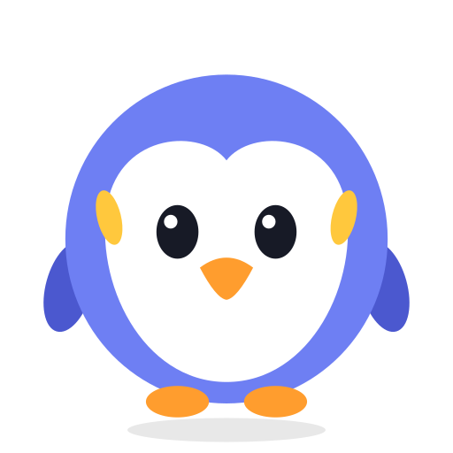
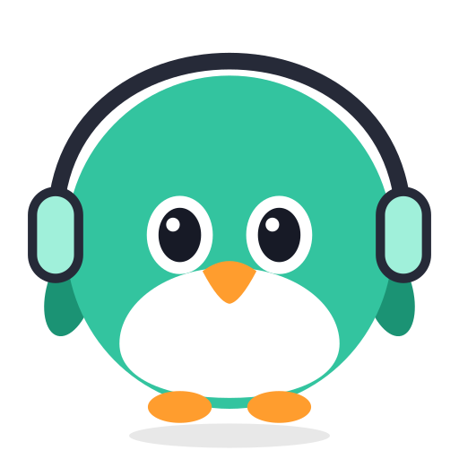
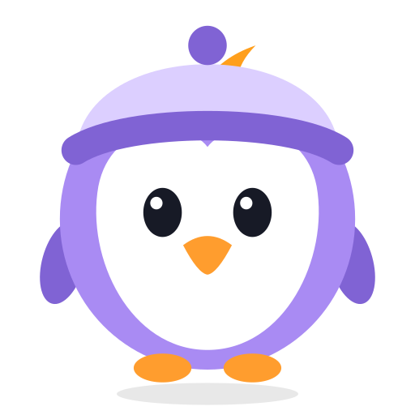
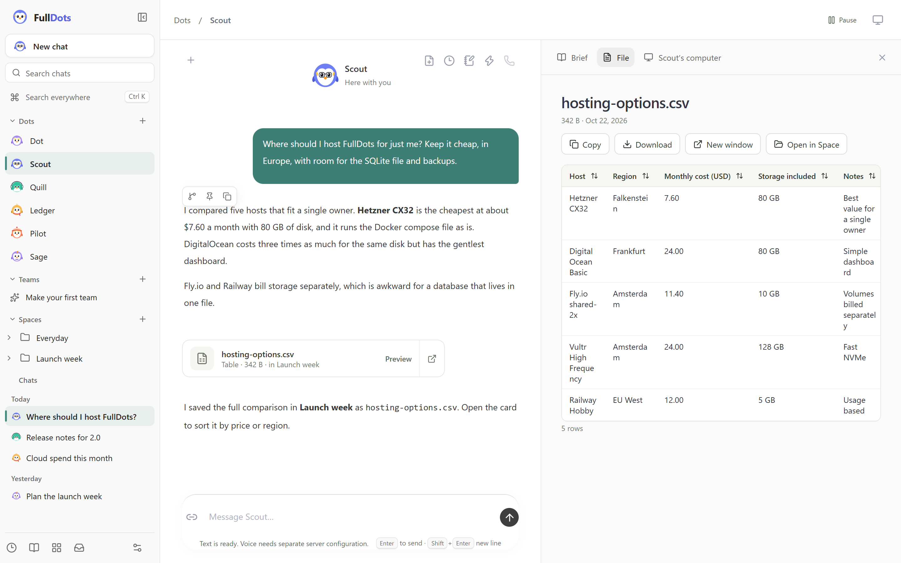
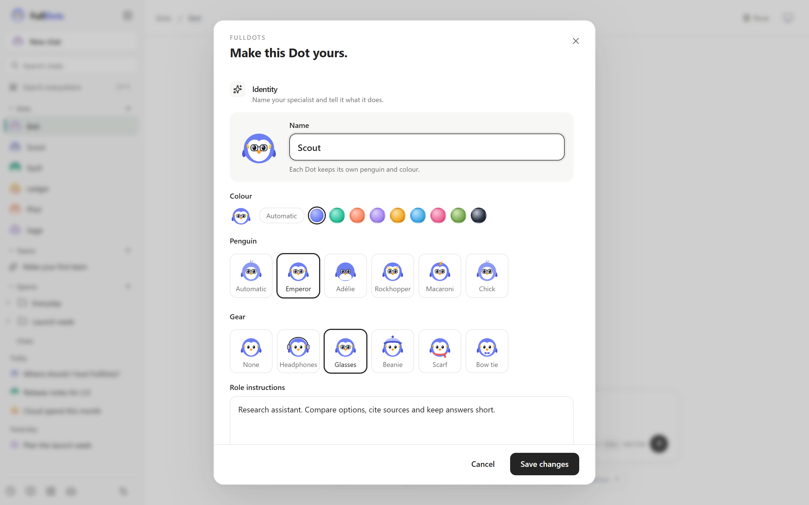
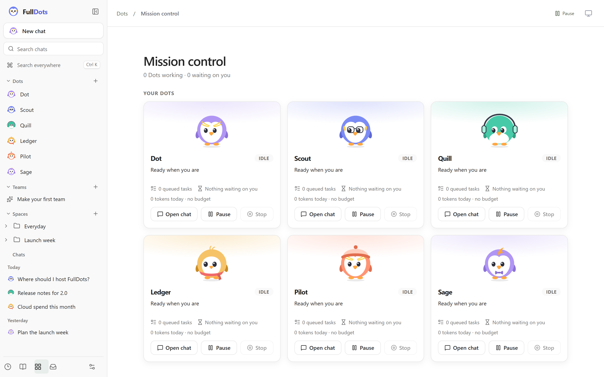
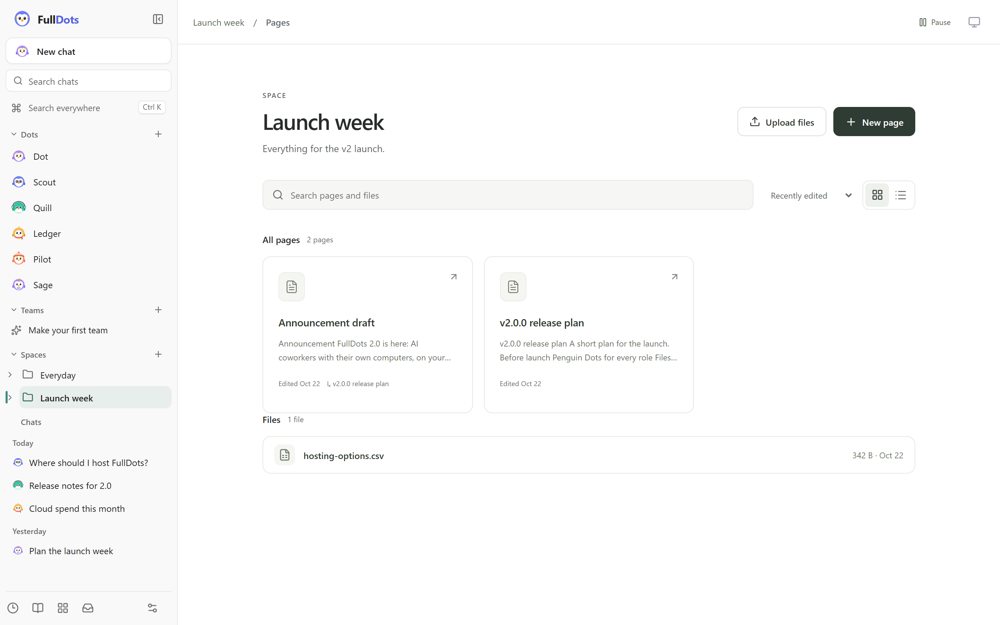
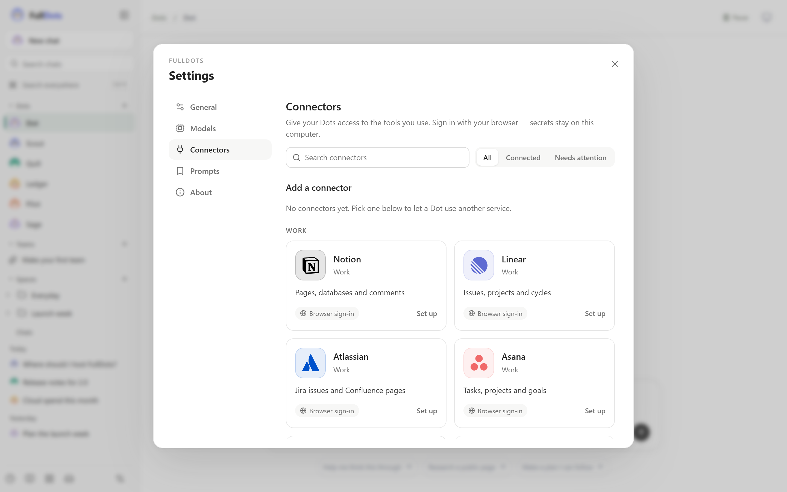
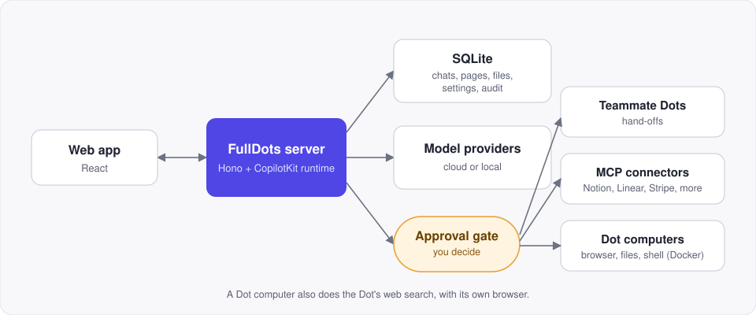

<div align="center">

<picture>
  <source media="(prefers-color-scheme: dark)" srcset="docs/brand/fulldots-logo-light.svg" />
  
</picture>

<br />

    

### AI coworkers with their own computers.

Self-hosted and local-first. Bring any model, connect your tools, and approve every risky action.

[](CHANGELOG.md)
[](https://github.com/asasemahmed/FullDots/actions/workflows/ci.yml)
[](LICENSE)


[](https://m8ven.ai/mcp/asasemahmed-fulldots-1p2yvw?s=readme)

[Quick start](#quick-start) · [Features](#features) · [How it works](#how-it-works) · [Documentation](#documentation) · [FullDots and OpenDots](#fulldots-and-opendots)

</div>

<br />



<sub>Scout compared five hosts, saved the result into a Space and the table opened beside the conversation. Nothing here left the machine except the model request.</sub>

<br />

**Hire a flock, not a chatbot.** Most AI tools give you one chat box and ask you to trust it. FullDots gives you a small team and keeps you in charge of it.

Each **Dot** is a coworker with a role, a model, the tools you grant it and, if you want, a computer of its own with a browser, files and a shell. You talk to it, hand it standing goals, let it call on its teammates and review what it did. Every Dot is a round penguin with its own colour, species and gear, so a team reads at a glance, and the penguin shows what it is doing right now.

Everything lives in one SQLite file. There are no accounts, no telemetry and no hosted service in the middle; the app talks only to the model providers and connectors you set up.

> [!NOTE]
> FullDots is built for a single owner: there are no user accounts or shared workspaces. It started as a fork of [CopilotKit OpenDots](https://github.com/CopilotKit/OpenDots); see [FullDots and OpenDots](#fulldots-and-opendots).

## What's new in 2.0

Version 2.0.0 is the first release that feels like a workplace rather than a prototype.

| Before                                              | Now                                                                                                                        |
| --------------------------------------------------- | -------------------------------------------------------------------------------------------------------------------------- |
| One Dot at a time, one chat at a time               | **Teams.** A Dot hands part of a task to the teammate whose role fits, and the answer returns to the same conversation.    |
| Results lived inside chat messages                  | **Spaces with files.** Dots save CSVs, reports and HTML pages, and a card in the chat opens them beside the conversation.  |
| A generic avatar                                    | **Penguin Dots.** Five species, five pieces of gear, nine colours, and live states: thinking, writing, working, waiting.   |
| Work stopped when you closed the tab                | **Always-on work.** Standing goals, webhook and poll triggers, parallel background turns and per-Dot token budgets.        |
| You asked, the Dot answered                         | **Mission control, an inbox and group chats.** See who is busy, what needs you, and `@mention` several Dots into one chat. |
| Searching depended on a service that blocks servers | **Search with the Dot's own browser**, a private SearXNG as a fallback, and a headed browser that captchas far less.       |
| Setting up Docker by hand                           | **Guided setup** for Dot computers. Every command is shown, and nothing runs until you allow it.                           |

The full list, including every ported upstream fix, is in the [changelog](CHANGELOG.md).

## Meet the flock

Dots are what you make them. These five come up in most setups.

|                                                                              | Dot        | A good job for it                                                       |
| ---------------------------------------------------------------------------- | ---------- | ----------------------------------------------------------------------- |
|    | **Scout**  | Research. Compares options, cites sources, saves tables and reports.    |
|       | **Quill**  | Writing. Turns rough notes into release notes, posts and documents.     |
|      | **Ledger** | Money. Watches spend and flags anything odd. Never pays without asking. |
|  | **Pilot**  | Operations. Drives a browser, files and a shell on its own computer.    |
|     | **Sage**   | Planning. Breaks a goal into steps and keeps the plan current.          |

Choose each Dot's colour, species (Emperor, Adélie, Rockhopper, Macaroni or Chick) and gear (headphones, glasses, beanie, scarf or bow tie) in its settings. Three pulsing dots mean it is thinking, hopping dots mean it is writing, focused eyes mean it is using a tool, an amber badge means it needs you, and confetti means it is done. The brand notes list every state: [docs/brand](docs/brand/README.md#the-dot).

<table>
<tr>
<td width="50%"></td>
<td width="50%"></td>
</tr>
<tr>
<td><sub><b>Make a Dot yours.</b> Colour, species and gear, then its role, model, connectors and approval rules.</sub></td>
<td><sub><b>Mission control.</b> Who is working, who is waiting on you, and what each Dot has used today.</sub></td>
</tr>
</table>

## A day with your Dots

A walk through what 2.0 is for, using nothing but the features in this repository.

1. **Morning.** Open mission control. Ledger finished a standing goal overnight and found nothing odd; Sage has a plan waiting for your review. One card in the inbox needs you: Pilot wants to publish a post.
2. **Ask.** You tell Scout to compare hosting for a single-owner deployment. It searches with its own browser, reads three pages and saves `hosting-options.csv` into the **Launch week** Space. The card opens a sortable table beside the chat.
3. **Hand off.** You ask Scout for release notes too. It passes that to Quill, who works in a separate conversation and returns the draft to Scout's chat. A lane in the chat shows Quill's progress while it works.
4. **Approve.** Pilot's post pauses on an approval card showing the exact text and destination. You approve that one action, once. A password prompt along the way stops Pilot instead: you take over its live screen, type the secret yourself and hand the screen back.
5. **Evening.** Ledger's budget warning lands in your notification webhook. You pause one Dot, run `npm run backup` and close the laptop. Anything that was waiting for you is still waiting after a restart.

## Principles

**Yours.** One SQLite file holds conversations, pages, files, settings and the audit trail. Keys and tokens are encrypted at rest with AES-256-GCM and never sent to the browser. Back everything up with `npm run backup`, even while FullDots runs.

**Asked first.** Sending, paying, deleting, publishing and destructive commands pause for you. An approval covers that exact action, once, and survives a restart. Dots reach only the Spaces, connectors and tools you grant, and connectors are read-only by default.

**Any model.** Fourteen provider presets, from OpenAI, Anthropic and Gemini to Ollama and LM Studio, plus any OpenAI-compatible server. Each Dot can use its own model.

## Screenshots

<table>
<tr>
<td width="50%"></td>
<td width="50%"></td>
</tr>
<tr>
<td><sub><b>Spaces.</b> Pages and files in one place, edited by you and by the Dots you grant.</sub></td>
<td><sub><b>Connectors.</b> Notion, Linear, Atlassian, Sentry, Stripe and more over MCP, signed in with your browser. No OAuth app to register.</sub></td>
</tr>
</table>

## Features

| Area              | What you get                                                                                                               |
| ----------------- | -------------------------------------------------------------------------------------------------------------------------- |
| **Chat**          | Pin, retry, branch, edit and resend; export a conversation as Markdown; `Ctrl+K` search across chats, pages, Dots, prompts |
| **Computers**     | One container per Dot with a browser, files and a shell; live screen, replay, take-over and an audit trail                 |
| **Notes**         | Visible notes of what each Dot remembers about you, which you can read, edit and roll back                                 |
| **Automations**   | Standing goals, schedules, webhook triggers with signed secrets, connector polls. See [Automations](docs/AUTOMATIONS.md)   |
| **Budgets**       | Tokens per Dot per day from the provider's own counts, a daily warning and an optional hard budget                         |
| **Limits**        | Steps, time, shell command time and file size, all set in `.env`                                                           |
| **Notifications** | Optional webhook for new approvals, hand-offs and usage warnings (title, text and link only)                               |
| **Tests**         | 2,079 tests, including a planted-secret leak test that fails if a key reaches a response, log or webhook                   |

## Quick start

**Requirements:** Node.js 24 or newer with npm, and either an API key for a supported provider or a local [Ollama](https://ollama.com) or [LM Studio](https://lmstudio.ai) server.

### From source

```sh
git clone https://github.com/asasemahmed/FullDots.git
cd FullDots
npm ci
cp .env.example .env
npm run dev
```

Open <http://127.0.0.1:5173>, then add a provider in **Settings → Models**. You can also set `OPENAI_API_KEY`, `OPENAI_BASE_URL` and `OPENAI_MODEL` in `.env` and restart. Without a model the app shows a setup screen and never invents replies.

### With Docker

```sh
cp .env.example .env    # set OWNER_TOKEN to a random string of 24+ characters
docker compose up --build -d
```

Open <http://localhost:4310>. The port is bound to loopback, and data lives in the `opendots-data` volume.

### On a server with Dokploy

Deploy from your own GitHub fork with HTTPS, a domain and redeploys on every push: see [Deploy on Dokploy](docs/DEPLOY-DOKPLOY.md).

### Optional extras

- **Dot computers** need Docker. The Computer panel can walk you through it. See [Computers](docs/COMPUTERS.md).
- **Page reader, voice calls and backups** are covered in [Setup](docs/SETUP.md).
- **Connectors** are added in **Settings → Connectors**. See [Connectors](docs/CONNECTORS.md).
- **Spaces** keep pages and files. See [Spaces](docs/SPACES.md).

## How it works



Every turn runs through the server. Before a Dot uses a computer, a connector or a teammate, the approval gate checks the action against that Dot's grants and approval mode. An action that needs you pauses the turn and is recorded, and the turn resumes once you decide. Only one turn runs per Dot at a time, across chat, voice, schedules and resumes, and a Stop button ends it.

## Configuration

All settings live in `.env`. [`.env.example`](.env.example) lists every variable with its default.

| Variable                                            | Purpose                                                                                     |
| --------------------------------------------------- | ------------------------------------------------------------------------------------------- |
| `OPENAI_API_KEY`, `OPENAI_BASE_URL`, `OPENAI_MODEL` | The built-in default provider. Add others in **Settings → Models**.                         |
| `OWNER_TOKEN`                                       | Required (24+ characters) when `HOST` is not loopback, and by the Docker setup.             |
| `APP_ORIGIN`                                        | The exact address you open the app at. Browser sign-in for connectors redirects back to it. |
| `DATABASE_PATH`                                     | The SQLite file. Default `data/opendots.sqlite`.                                            |
| `CONNECTOR_SECRET_KEY`                              | Key for stored secrets. If unset, `data/connector.key` is created once.                     |
| `WEB_SEARCH_PROVIDER`, `SEARXNG_URL`                | `duckduckgo` (default), `browser`, `searxng` (your own SearXNG) or `disabled`.              |
| `COMPUTER_BROWSER_MODE`                             | `headed` (default, far fewer captchas) or `headless` for Dot computers.                     |
| `SPACE_FILE_MAX_MB`                                 | Largest file a Space accepts. Default 10, at most 50.                                       |
| `CONNECTORS_ALLOW_STDIO`                            | Lets connectors start local programs. Off by default.                                       |
| `AGENT_TURN_TIMEOUT`, `AGENT_MAX_STEPS`             | How long and how many steps a Dot may take in one turn. Defaults: 90 seconds and 8 steps.   |
| `NOTIFY_WEBHOOK_URL`                                | Optional. Receives a title, text and link for new approvals, hand-offs and usage warnings.  |
| `BACKGROUND_CONCURRENCY`                            | Background tasks running at once (different Dots). Default 4, at most 8.                    |
| `DOT_DAILY_TOKEN_WARN`                              | Tokens per Dot per day before you are warned. Default 2,000,000.                            |
| `TEAM_MAX_DEPTH`, `DELEGATION_TIMEOUT`              | How many hand-offs may chain (default 2) and how long a teammate may work (default 300 s).  |

## Security

- **Your data stays local.** Outbound traffic goes only to your model providers, your search provider, the connectors you add and the pages a Dot reads.
- **Secrets are encrypted.** Model keys and connector tokens use AES-256-GCM. Secrets set in `.env` are read from the environment and never stored or shown.
- **Remote access needs a token.** The server refuses to start on a non-loopback `HOST` without an `OWNER_TOKEN` of 24+ characters.
- **Risky actions wait for you.** Approvals and hand-offs keep you in the loop. The checks are heuristics, not a sandbox; see [Approvals](docs/APPROVALS.md).
- **Stored files cannot run.** HTML a Dot saves previews in a frame with every sandbox restriction on, and scripts are only ever downloads. See [Spaces](docs/SPACES.md#security).
- **Leaks are tested.** [`tests/security.test.ts`](tests/security.test.ts) plants secrets where the server keeps them and checks that none reach a response, webhook, model request, stored conversation, audit record or log line.

FullDots has not been independently audited. Read [`SECURITY.md`](SECURITY.md) for the design, its limits and how to report a vulnerability privately.

## Development

```sh
npm test              # Vitest suite
npm run typecheck     # TypeScript, no emit
npm run lint          # ESLint
npm run check-format  # Prettier
npm run build         # production build, then `npm start`
npm run backup        # consistent copy of the database and its key
npm run brand         # redraw the logo and penguin art from the same code the app uses
```

<details>
<summary><b>Project layout</b></summary>

```text
src/
  client/    React app: chat, sidebar, Spaces, settings, Dot form, computer panel, penguins
  server/    Hono server: agent runtime, SQLite runner, connectors, approvals, teams, search
  shared/    Types and presets shared by client and server
  browser/   Page reader service (Playwright)
tests/       Vitest suites, fixtures and the security regression test
deployment/  Docker images for the app and Dot computers
docs/        Guides, brand assets and screenshots
```

</details>

<details>
<summary><b>Where each feature lives in the code</b></summary>

| Feature                 | Code                                                                                                                                                                                           |
| ----------------------- | ---------------------------------------------------------------------------------------------------------------------------------------------------------------------------------------------- |
| Local conversations     | [`sqlite-runner.ts`](src/server/sqlite-runner.ts)                                                                                                                                              |
| No telemetry            | [`privacy.ts`](src/server/privacy.ts), imported first in [`index.ts`](src/server/index.ts)                                                                                                     |
| Web search              | [`web-search.ts`](src/server/web-search.ts), [`browser-search.ts`](src/server/browser-search.ts)                                                                                               |
| Model providers         | [`model-providers.ts`](src/server/model-providers.ts), [`model-presets.ts`](src/shared/model-presets.ts)                                                                                       |
| Encrypted secrets       | [`connector-crypto.ts`](src/server/connector-crypto.ts)                                                                                                                                        |
| MCP connectors          | [`connectors.ts`](src/server/connectors.ts), [`connector-oauth.ts`](src/server/connector-oauth.ts), [`connector-auth-store.ts`](src/server/connector-auth-store.ts)                            |
| Approvals               | [`approval-gate.ts`](src/server/approval-gate.ts), [`approvals.ts`](src/server/approvals.ts), [`resume-queue.ts`](src/server/resume-queue.ts)                                                  |
| Owner hand-off          | [`handoff-service.ts`](src/server/handoff-service.ts), [`handoff-detect.ts`](src/server/handoff-detect.ts)                                                                                     |
| Teams                   | [`team-service.ts`](src/server/team-service.ts), [`lanes.ts`](src/server/lanes.ts)                                                                                                             |
| Spaces, pages and files | [`pages.ts`](src/server/pages.ts), [`space-files.ts`](src/server/space-files.ts), [`space-file-tools.ts`](src/server/space-file-tools.ts)                                                      |
| One turn per Dot        | [`turn-registry.ts`](src/server/turn-registry.ts)                                                                                                                                              |
| Live computer view      | [`computer-stream.ts`](src/server/computer-stream.ts), [`computer-panel/`](src/client/computer-panel/)                                                                                         |
| Work limits             | [`limits.ts`](src/server/limits.ts)                                                                                                                                                            |
| Audit and notifications | [`computer-store.ts`](src/server/computer-store.ts), [`notify.ts`](src/server/notify.ts)                                                                                                       |
| Penguin Dots            | [`penguin/engine.ts`](src/client/penguin/engine.ts), [`penguin/live.ts`](src/client/penguin/live.ts), [`DotCharacter.tsx`](src/client/DotCharacter.tsx), [`docs/brand/`](docs/brand/README.md) |

</details>

## Documentation

| Guide                                       | Covers                                        |
| ------------------------------------------- | --------------------------------------------- |
| [Setup](docs/SETUP.md)                      | Running, Docker, storage, search and backups  |
| [Deploy on Dokploy](docs/DEPLOY-DOKPLOY.md) | Hosting on your own server from GitHub        |
| [Models](docs/MODELS.md)                    | Providers, keys and per-Dot models            |
| [Connectors](docs/CONNECTORS.md)            | MCP connectors, browser sign-in and grants    |
| [Approvals](docs/APPROVALS.md)              | Modes, what pauses, hand-offs and resumes     |
| [Automations](docs/AUTOMATIONS.md)          | Goals, triggers, parallel work, token budgets |
| [Teams](docs/TEAMS.md)                      | Hand-offs between Dots                        |
| [Spaces](docs/SPACES.md)                    | Pages, files and what Dots can save           |
| [Computers](docs/COMPUTERS.md)              | A computer for each Dot                       |
| [Interface](docs/UI.md)                     | A map of the chat and sidebar                 |
| [Brand](docs/brand/README.md)               | Logo, penguin Dots, their states and colours  |
| [Roadmap](docs/ROADMAP.md)                  | What is done and what is next                 |
| [Changelog](CHANGELOG.md)                   | What changed in each release                  |

## FullDots and OpenDots

FullDots was forked from [CopilotKit OpenDots](https://github.com/CopilotKit/OpenDots) at upstream commit `c2569bb` (2 October 2026), and the upstream history is kept in this repository.

|                           | OpenDots at the fork point      | FullDots                                      |
| ------------------------- | ------------------------------- | --------------------------------------------- |
| Conversation storage      | Hosted CopilotKit Intelligence  | Local SQLite                                  |
| Web search                | Parallel by default, with a key | Keyless, or through the Dot's own browser     |
| Telemetry                 | CopilotKit telemetry            | Off                                           |
| Models                    | One provider set in `.env`      | 14 presets, encrypted keys, a model per Dot   |
| Connectors                | None                            | MCP with browser sign-in and per-Dot grants   |
| Approvals and hand-off    | None                            | Risky actions pause, and you type the secrets |
| Teams, Spaces with files  | None                            | Hand-offs, files and result cards             |
| Slack, Automatic Learning | Included                        | Removed (both depend on Intelligence)         |

OpenDots has kept moving since the fork. FullDots does not merge upstream wholesale; useful changes are ported one at a time, adapted and tested, and listed in the [changelog](CHANGELOG.md). Not ported: dark mode ([#81](https://github.com/CopilotKit/OpenDots/pull/81), FullDots will need its own), OpenDots's per-Dot MCP connections ([#52](https://github.com/CopilotKit/OpenDots/pull/52), FullDots has its own connectors), and anything tied to telemetry or the hosted Intelligence service.

FullDots is an independent project, not affiliated with or endorsed by CopilotKit. Thanks to Atai Barkai and the CopilotKit team for OpenDots, and for [CopilotKit](https://github.com/CopilotKit/CopilotKit), [AG-UI](https://docs.ag-ui.com) and [OpenBot](https://github.com/CopilotKit/OpenBot), which FullDots builds on. See [`NOTICE.md`](NOTICE.md).

## Contributing

Bug reports, fixes and tests are welcome. Please read [`CONTRIBUTING.md`](CONTRIBUTING.md) first, and report security problems privately as described in [`SECURITY.md`](SECURITY.md). The [open issues](https://github.com/asasemahmed/FullDots/issues) list what is up for grabs.

## License

[MIT](LICENSE). Copyright (c) Atai Barkai. Copyright (c) 2026 asemabdallah (FullDots modifications).
